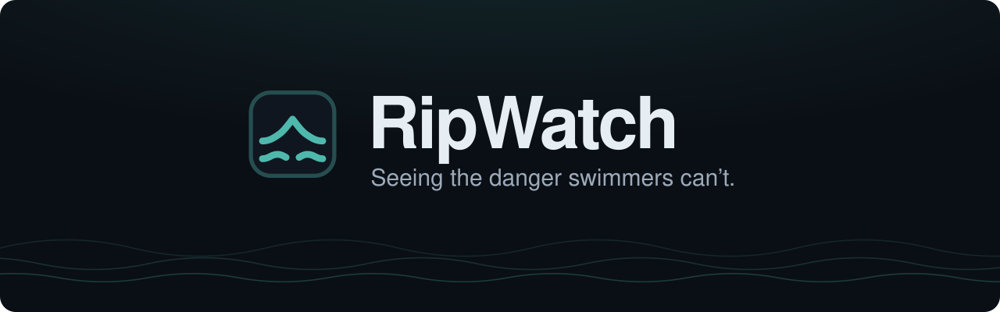
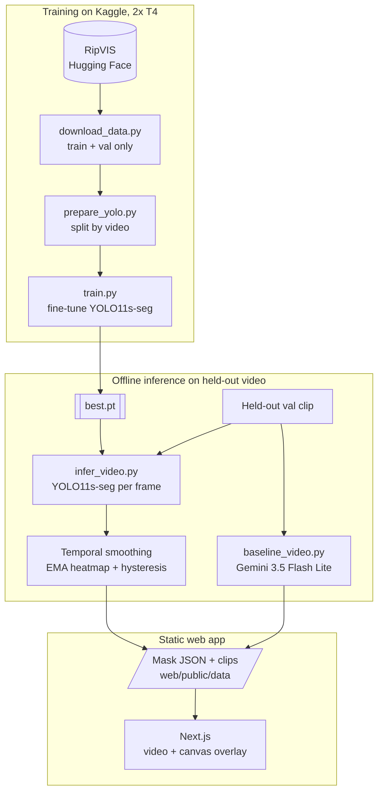
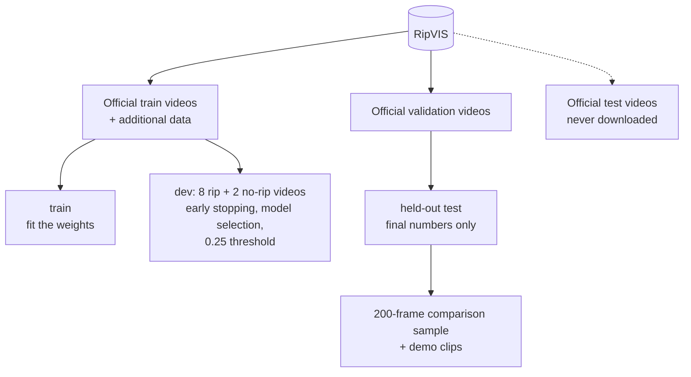
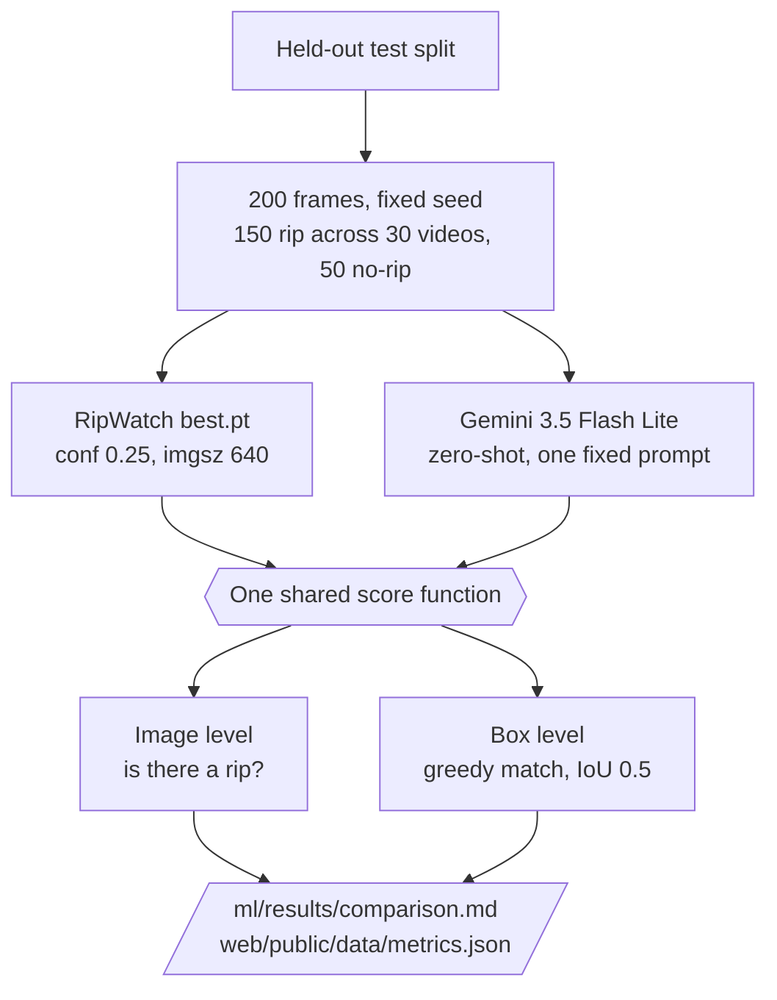

<p align="center">
  
</p>

<p align="center">
  <b>RipWatch watches beach camera video and outlines rip currents, so lifeguards can see them sooner.</b>
</p>

<p align="center">
  
  
  
  
  
  
  
  
  
  
</p>

<p align="center">
  <a href="#the-problem">Problem</a> ·
  <a href="#what-ripwatch-does">What it does</a> ·
  <a href="#architecture">Architecture</a> ·
  <a href="#results">Results</a> ·
  <a href="#responsible-ai-and-limitations">Limitations</a> ·
  <a href="#running-it">Run it</a>
</p>

---

## The problem

Rip currents are narrow channels of water flowing away from the shore. They often look like the calmest water on the beach, which is exactly why swimmers walk into them.

- **Drowning is a global killer.** The World Health Organization estimates **300,000 drowning deaths worldwide in 2021**. ([WHO, drowning fact sheet](https://www.who.int/news-room/fact-sheets/detail/drowning))
- **Rip currents dominate surf rescues.** According to the United States Lifesaving Association, rip currents are involved in **more than 80% of rescues by US surf beach lifeguards**. ([USLA, rip currents](https://www.usla.org/page/ripcurrents))
- **People cannot see them.** In a field study at Muriwai Beach, New Zealand, only **about 1 in 5 beachgoers (22%)** could spot a real rip current in person. ([Natural Hazards and Earth System Sciences, 2021](https://nhess.copernicus.org/articles/21/115/2021/))
- **It is not only an ocean problem.** Rip currents have taken lives on Lake Erie: in 2013, a Madison, Ohio middle school student drowned in the lake after being pulled out by a rip current. ([Fox 8 Cleveland (WJW)](https://www.yahoo.com/news/preventing-drownings-lake-erie-2025-200557140.html))

Lifeguards cannot watch every stretch of water every second. RipWatch is a second pair of eyes on the camera feed.

## What RipWatch does

1. **Watches a fixed beach camera.** For the demo, these are pre-recorded clips from the held-out RipVIS validation videos.
2. **Outlines rip currents on every frame** with a YOLO11s-seg model fine-tuned on RipVIS.
3. **Smooths the result over time**, so the outline holds steady instead of flickering frame to frame.
4. **Alerts the lifeguard.** The rip is painted red, the camera's status flips to *Rip detected*, and an alert card shows the confidence and how long the rip has been active, until a lifeguard acknowledges it.

The app also includes:
- A side-by-side **Compare** view: zero-shot Gemini against RipWatch on the same clip, in sync.
- A **Results** page built from the evaluation output.
- A **Pipeline** explainer.
- Two full-screen, keyboard-driven pages for recording the demo video: `/hook` and `/story`.

### Screenshots

> **TODO:** capture these on the recording laptop, which has all three demo clips, at 1920×1080, and save them under these names in [`docs/screenshots/`](docs/screenshots/). See [`docs/screenshots/README.md`](docs/screenshots/README.md) for what each one should show. Until then the images below are missing.

| Command dashboard | Compare |
|---|---|
|  |  |
| **Results** | **Pipeline** |
|  |  |
| **Story cards** | |
|  | |

## Architecture

### The whole system

Training and evaluation run offline. The web app is fully static: it plays video clips and draws precomputed masks in sync with them. There is no backend and no live model.



The data format between the two halves is defined in [`notes/contract.md`](notes/contract.md):
- one mp4 per clip;
- one mask file per clip and model, with per-frame polygons (RipWatch) or boxes (baseline) in source pixels;
- one `metrics.json`.

### Data splits (by video, never by frame)

Frames from the same video are nearly identical, so splitting by frame would leak the test set into training. Every split is made of whole videos.



| Split | Made from | Used for |
|---|---|---|
| **train** | Official RipVIS train videos minus the dev videos, plus the RipVIS additional data | Fitting the weights |
| **dev** | 8 rip and 2 no-rip whole videos carved out of official train (seed 42) | Early stopping, choosing `best.pt`, choosing the 0.25 threshold from the F1 curve |
| **held-out test** | The official RipVIS validation videos | Final metrics and the demo clips. Never used for training or tuning |

Per-split frame counts: **TODO** (printed by `prepare_yolo.py` on Kaggle; not saved in this repo).

### Evaluation



- Both models are scored by the same function in [`ml/scripts/eval_compare.py`](ml/scripts/eval_compare.py).
- Gemini is asked for boxes in its native format (`[ymin, xmin, ymax, xmax]` on a 0–1000 scale), which are converted before scoring.
- RipWatch is scored on its boxes, so both models are compared on the same footing.
- An unparseable Gemini answer would count as no detection. There were 0.

## Tech stack

| Layer | Tool | Why |
|---|---|---|
| Data | [RipVIS](https://huggingface.co/datasets/Irikos/RipVIS) via `huggingface_hub` | A large rip-current video dataset with instance segmentation masks, split by video by its authors |
| Model | Ultralytics YOLO11s-seg (PyTorch), COCO-pretrained | Real-time instance segmentation, small enough for a laptop CPU at inference |
| Training | Kaggle notebooks, 2× NVIDIA T4 | Free GPUs; multi-GPU training through Ultralytics DDP |
| Video and smoothing | OpenCV, NumPy, `imageio-ffmpeg` | Frame-accurate trims, heatmap smoothing, contour extraction |
| Baseline | Gemini API (`google-genai`), Gemini 3.5 Flash Lite | A general-purpose vision model, zero-shot, as a reference point |
| Web | Next.js 16 (App Router), React 19, TypeScript | A static demo app with no backend |
| UI | Tailwind CSS 4, React View Transitions | One small design system; calm route transitions |
| Charts | Recharts | The Results page comparison chart |
| Config | `python-dotenv`, Kaggle Secrets | API key handling on a laptop or in Kaggle |

## Dataset

[**RipVIS**](https://huggingface.co/datasets/Irikos/RipVIS) (CVPR 2025) is a video instance segmentation benchmark for rip currents: **184 videos, 212,328 frames, footage from 10 countries**.

- **License:** CC BY-NC 4.0, with additional non-commercial conditions from the authors. RipWatch is a non-commercial hackathon research demo.
- **Not redistributed:** no dataset video is committed to this repository. Clip mp4s are git-ignored and regenerated locally. The only excerpts here are the small contact sheets in [`docs/clip-candidates/`](docs/clip-candidates/), with attribution.
- **How we split it:** see [Data splits](#data-splits-by-video-never-by-frame). The official test split is never downloaded.

```bibtex
@inproceedings{dumitriu2025ripvis,
    author    = {Dumitriu, Andrei and Tatui, Florin and Miron, Florin and Ralhan, Aakash and Ionescu, Radu Tudor and Timofte, Radu},
    title     = {RipVIS: Rip Currents Video Instance Segmentation Benchmark for Beach Monitoring and Safety},
    booktitle = {Proceedings of the IEEE/CVF Conference on Computer Vision and Pattern Recognition (CVPR)},
    month     = {June},
    year      = {2025},
    pages     = {3427--3437}
}
```

## Model and training

| | |
|---|---|
| Architecture | YOLO11s-seg (Ultralytics), one class: `rip_current` |
| Starting point | COCO-pretrained `yolo11s-seg.pt` |
| Input size | 640 px |
| Hardware | Kaggle, 2× NVIDIA T4 (DDP) |
| Schedule | Up to 40 epochs, early stopping after 10 epochs without improvement on dev |
| Training time | About 2.5 hours on 2× T4, including data download and preparation |
| Epochs actually trained | **TODO** (`ml/results/train_s/results.csv` is not in this repo; count its rows once it is added) |
| Held-out test, mask mAP50 | **0.615** (precision 0.69, recall 0.55; Ultralytics segmentation validation on the held-out test split) |
| Operating threshold | **0.25** confidence, chosen from the dev-set F1 curve, never from test data |

See [`ml/scripts/train.py`](ml/scripts/train.py) for the exact arguments. The mAP50 above is Ultralytics' own segmentation metric. The comparison with Gemini below uses our own scoring at the 0.25 threshold, so the two are not directly comparable.

**Temporal smoothing** ([`ml/scripts/infer_video.py`](ml/scripts/infer_video.py)) turns per-frame predictions into a steady outline:
- **Heatmap:** a per-pixel rip heatmap at 320 px on the long side.
- **EMA:** an exponential moving average with alpha 0.3.
- **Hysteresis:** a region turns on at 0.45 and off at 0.25.
- **Polygons:** OpenCV contours, simplified, with regions under 0.2% of the frame dropped.

Each region's confidence is the mean heatmap value inside it. It runs lower than the raw model score, so the web app's alert threshold defaults to 0.30.

## Results

> **Out of 150 held-out frames with a rip current, Gemini 3.5 Flash Lite flagged 39. RipWatch flagged 108.**

Both models had about 95% precision, so the difference is recall: 0.26 against 0.72.

**Image level** ("is there a rip in this frame?"), 200 held-out frames (150 rip, 50 no-rip):

| Model | TP | FP | FN | TN | Precision | Recall | F2 |
|---|---|---|---|---|---|---|---|
| Gemini 3.5 Flash Lite (zero-shot) | 39 | 2 | 111 | 48 | 0.951 | 0.260 | 0.304 |
| RipWatch (fine-tuned YOLO11s-seg) | 108 | 5 | 42 | 45 | 0.956 | 0.720 | 0.757 |

**Box level** (greedy matching at IoU ≥ 0.5 against the boxes around the labelled rip polygons; 218 ground-truth boxes):

| Model | TP | FP | FN | Precision | Recall | F2 |
|---|---|---|---|---|---|---|
| Gemini 3.5 Flash Lite (zero-shot) | 4 | 37 | 214 | 0.098 | 0.018 | 0.022 |
| RipWatch (fine-tuned YOLO11s-seg) | 105 | 58 | 113 | 0.644 | 0.482 | 0.507 |

F2 = 5PR / (4P + R) weights recall above precision, because a missed rip costs more than a false alarm.

```text
Image-level recall (rip frames found, out of 150)
  Gemini 3.5 Flash Lite  █████████████                                       0.26   (39)
  RipWatch               ████████████████████████████████████                0.72  (108)

Image-level F2
  Gemini 3.5 Flash Lite  ███████████████                                     0.304
  RipWatch               ██████████████████████████████████████              0.757

Box-level F2 (IoU 0.5)
  Gemini 3.5 Flash Lite  █                                                   0.022
  RipWatch               █████████████████████████                           0.507
```

Source: [`ml/results/comparison.md`](ml/results/comparison.md) and [`web/public/data/metrics.json`](web/public/data/metrics.json). The 200 frames are listed in [`ml/results/eval_frames.txt`](ml/results/eval_frames.txt), and Gemini's raw answers are in [`ml/results/baseline_raw.jsonl`](ml/results/baseline_raw.jsonl).

### Demo clip results

The three demo clips are held-out validation videos.
- **RipWatch:** runs on every frame, with smoothing on, at conf 0.25.
- **Gemini 3.5 Flash Lite:** sees one frame per second. Each answer is held until the next sampled frame.

| Clip | Source | RipWatch: frames with a rip | Gemini 3.5 Flash Lite: frames with a box |
|---|---|---|---|
| `clip1_obvious` | RipVIS-053, 0–15 s | **99.6%** | 80.0% (12 of 15 sampled) |
| `clip2_sneaky` | RipVIS-144, 0–13 s | **88.5%** | 0.0% (0 of 14 sampled) |
| `clip3_norip` | RipVIS-NR-004, full | **0.0%** (correct, no rip) | 10.2% (2 of 20 sampled; false alarms at 3 s and 16 s) |

**Documented failure: RipVIS-129.** It was our first choice for the "sneaky" clip.
- **What happened:** the ground truth shows a rip, but RipWatch gave no detections on any frame of the chosen window.
- **Raw scores:** single-frame probes at conf 0.05 never went above 0.27.
- **What we did:** we replaced it with RipVIS-144 and kept 129 as a known failure, instead of hiding it. Details are in [`docs/clip-candidates/README.md`](docs/clip-candidates/README.md) and [`notes/ml.md`](notes/ml.md).

Gemini's raw answers for the clips are in [`ml/results/baseline_video/`](ml/results/baseline_video/).

## Responsible AI and limitations

- **Advisory only.** RipWatch points a lifeguard's attention. It never opens or closes a beach, and it does not replace trained judgment.
- **No flash rips.** It is built for rip currents that persist across many frames. Short-lived flash rips are out of scope.
- **Not tested on live cameras.** Everything was evaluated on recorded RipVIS video, never on a live camera feed.
- **Rain, fog and night are untested.**
- **Small evaluation sample.** The comparison uses 200 held-out frames (150 rip, 50 no-rip) from one run, with no repeated trials. RipWatch raised a false alarm on 5 of the 50 no-rip frames (Gemini 3.5 Flash Lite: 2 of 50).
- **A deliberately lightweight baseline.** Gemini 3.5 Flash Lite is a small model, used zero-shot with one fixed prompt, chosen because of free-tier API limits.
  - The result says nothing about other Gemini models or other general-purpose models.
  - It was not built for precise localization, so the image-level result is the fairer comparison.
- **Non-commercial data.** RipVIS is CC BY-NC 4.0, so RipWatch is a research demo, not a product.

## Repository structure

```text
RipWatch/
├── ml/                          # data, training, evaluation, demo clips (Python)
│   ├── scripts/
│   │   ├── download_data.py     # RipVIS from Hugging Face: train/val subset, never test
│   │   ├── prepare_yolo.py      # YOLO-seg dataset, video-level train/dev/test splits
│   │   ├── train.py             # fine-tune YOLO11s-seg (Kaggle, 2x T4)
│   │   ├── baseline_vlm.py      # Gemini on the 200 held-out frames (resumable)
│   │   ├── eval_compare.py      # one scoring function for both models
│   │   ├── find_clips.py        # shortlist demo clips from the val split
│   │   ├── video_clip.py        # frame-accurate trims, shared by the two below
│   │   ├── infer_video.py       # RipWatch masks per frame + temporal smoothing
│   │   ├── baseline_video.py    # Gemini boxes for the demo clips
│   │   └── common.py            # paths, env loading, shared helpers
│   ├── tests/                   # synthetic tests with stubbed ultralytics / google-genai
│   ├── results/                 # comparison.md, eval frames, Gemini raw answers
│   ├── requirements.txt
│   └── .env.example
├── web/                         # Next.js demo app (no backend)
│   ├── app/                     # routes: /, /compare, /results, /pipeline, /hook, /story
│   ├── components/              # MaskedVideo, FeedTile, AlertCard, LogoMark, ...
│   ├── lib/                     # data loaders, frame math, clip metadata
│   └── public/data/             # metrics.json, mask JSON (clip mp4s are git-ignored)
├── docs/
│   ├── assets/                  # logo.svg, banner.svg
│   ├── screenshots/             # README screenshots (TODO)
│   ├── clip-candidates/         # how the demo clips were picked, with contact sheets
│   └── video-script.md          # the 3-minute video script
└── notes/                       # data contract and team logs
```

## Running it

### ML (`ml/`)

Python 3.10+. Training and the frame-level evaluation are meant for a Kaggle notebook with a GPU. The demo-clip scripts also run on a laptop CPU.

```bash
pip install -r ml/requirements.txt
```

**1. Data and training (Kaggle)**

```bash
python ml/scripts/download_data.py                  # RipVIS train/val subset, never test
python ml/scripts/prepare_yolo.py                   # YOLO-seg dataset; official val becomes the held-out test set
python ml/scripts/train.py                          # fine-tune YOLO11s-seg (--smoke for a 2-epoch check)
```

Run `train.py` as `!python ...` in the notebook, not inside the kernel, so multi-GPU DDP works.

**2. Evaluation.** This needs `GEMINI_API_KEY`; see [Environment](#environment).

```bash
python ml/scripts/baseline_vlm.py --model gemini-3.5-flash-lite      # Gemini on the 200 held-out frames (rerun to resume)
python ml/scripts/eval_compare.py --weights ml/weights/best.pt \
    --baseline-model gemini-3.5-flash-lite --conf 0.25               # scores both, writes comparison.md + metrics.json
```

For a Gemini-only account that never trains, `download_data.py --splits val` and `prepare_yolo.py --splits val` fetch and build just the held-out test split.

**3. Demo clips.** These write `web/public/data/clips/` and `web/public/data/masks/`.

```bash
python ml/scripts/find_clips.py                     # shortlist val clips, see docs/clip-candidates/
python ml/scripts/infer_video.py --weights ml/weights/best.pt --video ml/data/videos/RipVIS-053.mp4 --clip-id clip1_obvious --start 0 --end 15
python ml/scripts/baseline_video.py --video ml/data/videos/RipVIS-053.mp4 --clip-id clip1_obvious --start 0 --end 15
python ml/tests/test_demo_clips.py                  # synthetic tests, no model or API key needed
```

Step-by-step notebook cells and the commands for all three clips are in [`notes/ml.md`](notes/ml.md) and [`docs/clip-candidates/README.md`](docs/clip-candidates/README.md).

### Web (`web/`)

Node.js and npm.

```bash
cd web
npm install
npm run dev        # http://localhost:3000
npm run build      # production build (all routes are static)
npm start          # serve the production build
```

| Route | What it shows |
|---|---|
| `/` | Command dashboard. Keys `1`–`3` switch the main camera |
| `/compare` | Gemini (zero-shot) and RipWatch on the same clip, one shared clock |
| `/results` | The evaluation results from `metrics.json` |
| `/pipeline` | How a camera frame becomes a lifeguard alert |
| `/hook` | Full-screen opener for the video. `M` reveals the mask, `Space` plays or pauses, `R` restarts, `1`–`3` switch clips |
| `/story` | Title, statistic and closing cards for the video. `→` or `Space` next, `←` back, `R` restart |

Clip mp4s are git-ignored because of the dataset license, so generate them with the demo-clip commands first. Without them, a camera tile shows *Awaiting footage* with a neutral *No signal* status, and it never draws a mask or raises an alert, because nothing is analysed until video loads.

### Environment

| Variable | Where | Used by |
|---|---|---|
| `GEMINI_API_KEY` | `ml/.env` (copy [`ml/.env.example`](ml/.env.example)), the shell environment, or a Kaggle Secret named `GEMINI_API_KEY` | `baseline_vlm.py`, `baseline_video.py` |

`ml/.env` is git-ignored. The web app needs no environment variables.

## Built at HackOHI/O 2026

Everything in this repository was built during HackOHI/O 2026:
- the data preparation, training and evaluation scripts;
- the temporal smoothing;
- the demo-clip pipeline;
- the web app, its design and the logo.

Pre-existing tools and data we used:

- **RipVIS dataset** (CC BY-NC 4.0), for training and evaluation data.
- **Ultralytics YOLO11** and its COCO-pretrained `yolo11s-seg` weights, as the starting point for fine-tuning.
- **Gemini API**, for the zero-shot baseline.
- **Kaggle**, for free GPU notebooks.
- **Next.js, React, Tailwind CSS, Recharts** and the usual open-source libraries listed in `ml/requirements.txt` and `web/package.json`.
- **Claude Code** (AI coding assistant), used while writing code and documentation.

## Team

- **Tejas Naik**
- **Sid Guddanti**

## Acknowledgments

- The **RipVIS authors** (Andrei Dumitriu, Florin Tatui, Florin Miron, Aakash Ralhan, Radu Tudor Ionescu, Radu Timofte), for releasing a rip-current video dataset with instance masks.
- **Ultralytics**, for YOLO11 and its training tooling.
- **Kaggle**, for the free GPUs that trained the model.
